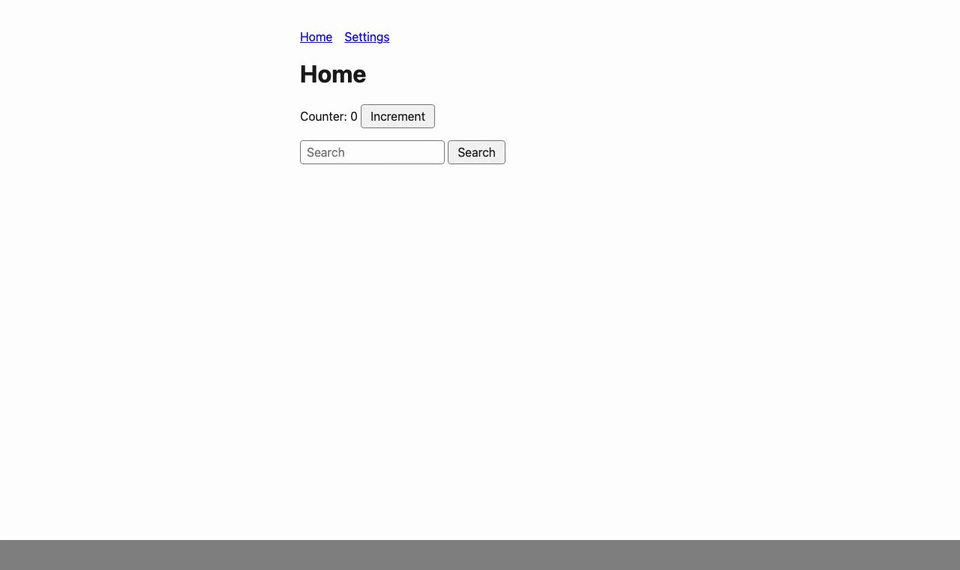
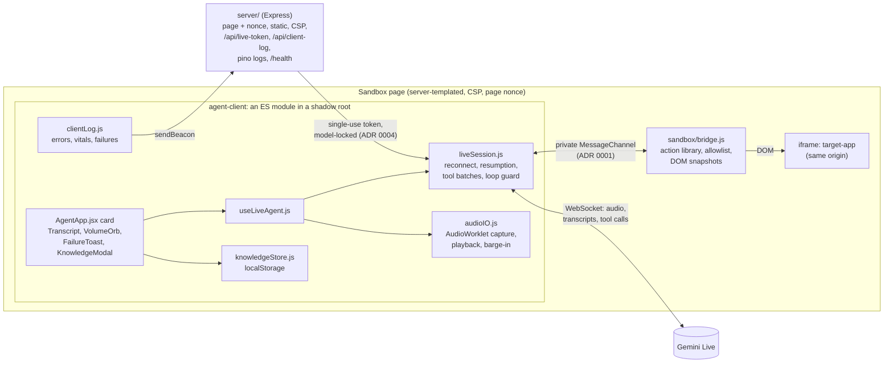
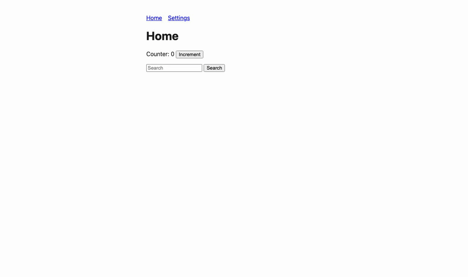
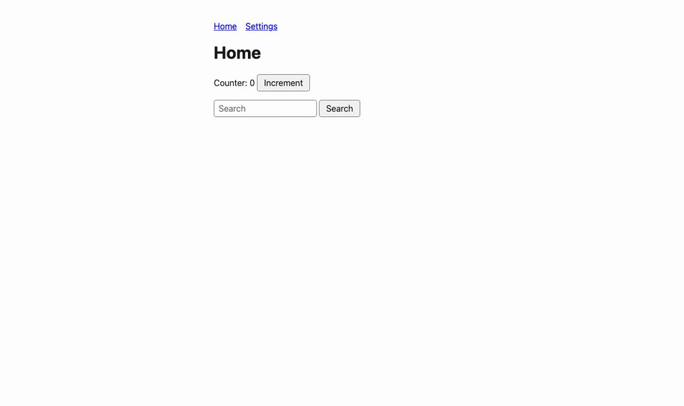

# AI Presenter Agent (v2)

A rebuild of the runtime half of a Presenter Agent — an AI avatar embedded in a demo that talks
*and* acts (click/scroll/navigate/fill) on the app behind it, hardened against the gaps found in
the v1 build. It also has a small RAG-lite knowledge feature: add or drop `.txt`/`.md` files, and
standing rules, in a dialog and the agent gets them as context, stored only in your browser's `localStorage`.

**Live:** <!-- LIVE_URL --> not deployed yet ([#23](https://github.com/jovstern/ai-presenter-agent/issues/23)); once it is (Render's free plan: the first visit after it has been idle takes
about 30 s to wake it). Open it on https, press **Talk to the AI Presenter**, allow the mic, and
ask it to "increment the counter twice, then go to Settings, turn on notifications and save".



Start with [`docs/project-knowledge-handoff.md`](./docs/project-knowledge-handoff.md) — the full
origin story, what's actually verified vs. just written, every caveat, and what's planned next.
[`docs/demostack-ai-presenter-agent.md`](./docs/demostack-ai-presenter-agent.md) is the build spec
and [`docs/sandbox-simulation.md`](./docs/sandbox-simulation.md) explains why this build fakes the
"cloned app" the way it does instead of embedding a real external site. Architecture decisions are
in [`docs/adr/`](./docs/adr/); the current build cycle's assessment, spec and milestone plan are in
[`docs/superpowers/`](./docs/superpowers/); open review items are tracked in
[`docs/code-review-notes.md`](./docs/code-review-notes.md). The words the code uses (bridge,
channel, keyframe, nonce, generation…) are defined in [`CONTEXT.md`](./CONTEXT.md).

**Not included on purpose:** the agent-creation UI, the template/demo-agent data model, the flow
builder, RAG upload. This build is about the runtime — sandbox, grounding, security, resilience,
performance — see the docs for why.

## Layout

```
docs/            spec, handoff, review checklist, ADRs (docs/adr/), build cycle (docs/superpowers/),
                 the observer's metrics per milestone (docs/metrics/)
target-app/      static mock "cloned app" (3 pages + their scripts: Home, Settings, and Orders,
                 a 60-row table and a form past the snapshot cap; routes.json: the one route list)
sandbox/         the host page: iframe + the MessageChannel bridge (ADR 0001) + action library
agent-client/    npm package: the React app built into an ES module (plus the Gemini SDK as a
                 chunk loaded on Talk), mounted in a shadow root
server/          npm package: mints a short-lived Gemini Live token, serves everything else
                 with a CSP and security headers (helmet), JSON request logs (pino), /health,
                 and /api/client-log for the agent-client's error and vitals beacons
render.yaml      the Render Blueprint (see Deploy)
```

Two npm packages (`agent-client`, `server`), two static directories (`sandbox`, `target-app`),
and a thin root `package.json` (no workspaces) holding Prettier, Playwright and the
cross-package scripts. `e2e/` holds the Playwright suite.

## Architecture



The agent-client gets a short-lived token from the server (the API key never reaches the
browser) and talks to Gemini Live directly. The model's tool calls (click, fill, scroll,
navigate) go over a private `MessageChannel` to `sandbox/bridge.js`, which acts on the
same-origin iframe and sends back DOM snapshots — a keyframe, or a delta when little changed —
so the model can see what its actions did. A dropped socket reconnects once per drop on a
backoff and resumes the session.

Decisions:
- [ADR 0001](docs/adr/0001-private-bridge-channel.md) — the agent ↔ bridge traffic runs on a
  private `MessageChannel`, not `window.postMessage`.
- [ADR 0002](docs/adr/0002-type-checking-with-checkjs.md) — type checking with `checkJs` +
  `strict` on plain JS, not a TypeScript migration.
- [ADR 0003](docs/adr/0003-hosting-on-render.md) — hosting on Render from a Blueprint.
- [ADR 0004](docs/adr/0004-live-token-constraints.md) — the Live token is locked to the model
  only.
- [ADR 0005](docs/adr/0005-load-the-gemini-sdk-on-talk.md) — the Gemini SDK is a chunk of its
  own, loaded on Talk (or when Talk is pointed at or focused), not on page load: 107.8 kB gzip
  on page load instead of 179.6.

## Run it

You need Node 24 (`.nvmrc`; `nvm use` picks it up) and a Gemini API key:
https://aistudio.google.com/apikey

```bash
# 1. build the agent-client once (or `npm run watch` in its own terminal to rebuild on save)
cd agent-client
npm install
npm run build

# 2. start the server
cd ../server
npm install
cp .env.example .env   # paste your key into GEMINI_API_KEY
npm start
```

Then open **http://localhost:3000/** (or `/sandbox/`, which serves the same page; the port is
`PORT` if you set one, 3000 otherwise). Press **Talk to the AI Presenter** on the agent card in the bottom-right
corner and allow microphone access: the agent greets you once the session is open (it does not
speak on page load). Try asking it to increment the counter, search for something, or go to
Settings, turn on notifications and save. The card's one button follows the connection: Talk
to the presenter, a pending Cancel while connecting, End while live or reconnecting, and Retry if
the connection is lost for good. When retrying can't help, it says what can: Reload page when
the page's token is rejected, or Try again (asks the server once more) when the server isn't
configured, which a reload can't fix. A failure also shows a toast above the card, once, with
the reason and Dismiss (F8 reaches it from the keyboard); once it closes, the reason stays
under the status line. Click the knowledge button (the document icon and a count) on the card to drop in `.txt`/`.md` files it should know about
in advance; they stay in your browser's `localStorage`.

After the first install and `.env` setup, `npm run dev` from the repo root builds agent-client
and starts the server in one step.

The server reads its env once at startup (`server/config.js`, Zod): `PORT` (default 3000),
`GEMINI_API_KEY`, `NODE_ENV` (`development`, `production` or `test`), `LOG_LEVEL` (a pino
level, default `info`) and `TRUST_PROXY_HOPS` (default 1 in production, 0 otherwise). A bad
value stops it with a message naming the variable (never its value). Without a key it still
starts locally and the card offers Try again; with `NODE_ENV=production` a missing key stops
it, so a deploy without one fails instead of going live broken.

## Deploy (Render)

`render.yaml` is a Render Blueprint ([ADR 0003](docs/adr/0003-hosting-on-render.md)): one free
Node web service that builds agent-client, installs the server's production dependencies and
runs `npm --prefix server start`, with `NODE_ENV=production`, a `/health` check and a preview
instance per pull request. Node comes from `.nvmrc`. A push to `master` deploys only once
its CI checks pass (`autoDeployTrigger: checksPass`).

1. In the Render dashboard: **New → Blueprint**, pick this repository; Render reads
   `render.yaml`.
2. When it asks for `GEMINI_API_KEY` (`sync: false`, so it never lives in the repo), paste the
   key, then create. A pull request preview copies its base service's env vars, so previews
   run on the production key: each is a public URL minting on the same quota (accepted for a
   solo repo; ADR 0003).
3. Open the service's `onrender.com` URL. The free plan sleeps when idle, so the first visit
   after a while takes about 30 s.

Behind Render's TLS proxy the server trusts one proxy hop (`trust proxy`), so the token
route's same-origin check sees `https` and both rate limiters see each viewer's own IP. If the
deployed `X-Forwarded-For` turns out to carry more hops, set `TRUST_PROXY_HOPS` instead of
changing code.

## Observability

Everything lands in the server's stdout as pino JSON lines, which is what Render's **Logs**
tab shows (one JSON object per line; its search box matches any text in it).

- **Requests** — every request but `/health` (Render polls it) is one `"msg":"request completed"` line with the request id
  (`reqId`, also sent back as `x-request-id`), method, path (never the query, which carries the
  page nonce), status and `responseTime` in ms. A failed token mint is an error line, `live token
  mint failed`; a minted one is `live token minted` (never the token).
- **Client reports** — the agent-client (`agent-client/src/clientLog.js`, started once per
  page by `main.jsx`) sends `navigator.sendBeacon` reports to `POST /api/client-log`, each
  logged as one line with a `client` object and the beacon's `reqId`:
  - `client vital` (info) — the real user's LCP, INP and CLS from `web-vitals`
    (`{ name, value, rating, id }`; value in ms, CLS unitless), sent when each is final (LCP
    on the first input, INP and CLS when the page is hidden);
  - `client error` (warn) — an uncaught error or unhandled rejection thrown from the
    agent-client's own script (`{ message, source, stack }`), not the host page's or the
    target app's; a repeated error is sent once, at most 10 per page;
  - `client connection failed` (warn) — each time the card goes to a failed connection, once
    per failure (`{ kind, reason, attempt }`; `kind` is `config` — no key, or Google rejects
    it — or `exhausted` — the reconnect backoff ran out). A `token` failure (the server
    refused the page's nonce) is not sent: the beacon carries the same nonce and would be
    refused too.

  At most 20 reports per page. The endpoint has the token route's gates — same origin, the
  page nonce (in the query: a beacon can't set headers) and a per-IP rate limit of its own (60
  a minute, so log spam can't spend the token budget) — and a 4 kB body cap (413), a Zod body
  (400 for anything else) and a 204 answer. Strings are cut to length and URLs lose their
  query and fragment before they are logged, so a socket URL's token never reaches the log.

  **What gets lost.** A beacon the server rejects (403) still logs a console error in the
  viewer's browser, and its report is gone. Nonces live in the server's memory for 1 h, so a
  page open longer than that, or one that outlived a server restart (the free plan spins down
  after ~15 min idle), has a dead nonce and its reports are rejected. Once the card's token
  request is refused, the page stops sending; until then its reports are lost. So field vitals
  under-count long sessions — and INP and CLS, sent when the page is hidden, are the ones most
  often lost.

To find a viewer's problems in Render: search `client connection failed` or `client error`;
for real-user performance, search `client vital` and read `client.name`, `client.value` and
`client.rating`.

## Test

```bash
npm install     # at the repo root, once: Prettier, Playwright, axe
npx playwright install chromium   # once, for the e2e
npm run check   # Prettier check, then lint + typecheck + tests + build in agent-client,
                # lint + typecheck + tests in server
npm run e2e     # Playwright (Chromium): 7 specs, 49 tests, no Gemini key needed
npm run e2e:live  # opt-in, macOS: the live e2e against the real Gemini Live API (needs the key)
npm run format  # Prettier write

cd agent-client
npm test        # vitest: 21 files, 449 tests
npm run lint    # ESLint: agent-client plus sandbox/, target-app/ and the e2e/ suite
npm run typecheck  # tsc: checkJs + strict, sandbox/bridge.js included; the capture worklet
                   # in its own project (jsconfig.worklet.json, AudioWorklet globals only),
                   # and the unit tests in theirs (jsconfig.tests.json)
npm run build   # agent-client/dist/: agent-client.js (an ES module), the SDK chunk
                # web-<hash>.js (ADR 0005), and public/capture-worklet.js

cd ../server
npm test        # vitest + supertest: 5 files, 120 tests
```

The suite in `agent-client/src/__tests__/`:

- `liveSession.test.js` — the session state machine against a fake Live client: one reconnect
  per drop, superseded connects, in-order tool batches, the token and model it connects with,
  resumption without re-greeting, the
  `reconnecting` → `failed` sequence, a token response with no token retried, the loop guard (a cycle's third round refused, ten counter clicks that each move the page on all run while
  four no-op clicks are refused, toggle/save/toggle/save over pages that all differ runs (#28) and its third round is refused, a loop refusal telling the model to stop and ask the user, the 51st action of a request refused with a stop-and-ask, one corrective turn
  per repeated-sentence episode, never sent to a replacement session; the user speaking clears
  the action window, and narration between tool calls is no loop), the SDK's real order
  (setupComplete and a queued tool call delivered before `connect()` resolves: still answered,
  and before any client turn — the knowledge and the greeting wait for its response, as does a
  knowledge change during any batch; the greeting by whether the attempt resumed),
  `dispose()`; a resume refused as "already connected" keeps its handle; a snapshot that arrives
  during a tool batch goes out inside the next tool response (`page`), one per call of a batch; a still-attached refusal
  retried after 400 ms × the attempt; knowledge not resent to a resumed session unless it changed after the handle (M9); the `ds:*`
  timing and size marks; the 10 s setup timeout; the handle kept on a network failure and dropped
  on a server close; the backoff reset only after 5 s open or the first content; the fatal
  kinds (`config`, `token`, and `sdk`: an SDK chunk that didn't load fails at once, with no
  backoff, and the next connect loads it); the token requested while the SDK is still loading.
- `liveSdk.test.js` — the SDK loader: one import shared by every caller, a failed one turned
  into an `SdkLoadError` and forgotten so the next call imports again; no file in `src/`
  imports `@google/genai` statically, and `liveSdk.js` is the one dynamic importer.
- `useLiveAgent.test.jsx` — the hook and card (Testing Library): no stacked mic on a double
  Talk, plain http (or no AudioWorklet) explained with no session opened, cleanup on unmount, the button per state (a pending Cancel, End while reconnecting, Retry,
  Reload page on a rejected token, Try again and no Reload page on a `config` failure) with focus kept on it, the status line ("Can't connect" when fatal) and the mic alerts (a repeated one re-announced), any capture failure ending the session, the card a named landmark, the session's fragments coalesced into turns; the failure toast shown once per failure (not again after it closes, a new one for a new failure), the reason announced exactly once (by the toast, not a card alert), its action and Escape leaving focus on the card's button, and the Tab walk from F8.
- `clientLog.test.js` — the client log: only the bundle's own errors and rejections reported
  (by the directory it is served from, so the SDK chunk's count), with their message, source and clipped stack; a vital cut to name,
  value, rating and id; a failure's kind (`exhausted` when not fatal); one beacon per report
  with the nonce in the query and a JSON Blob, nothing without a nonce, a repeated error sent
  once, at most 10 errors and 20 reports per page, a missing or refusing `sendBeacon` dropped
  silently, nothing sent once disabled, and a `token` failure neither sent nor followed by
  anything; `useLiveAgent.test.jsx` checks the card reports each failure once.
- `transcript.test.js` / `Transcript.test.jsx` — fragments merged per speaker (verbatim within a
  turn, one space across a turn boundary), bounded to 20; rendered in a polite live region that
  announces additions only, a node per fragment, the speaker named for assistive tech; the
  reserved box, short content drawn at its bottom, following the newest line unless the viewer
  scrolled up, a Tab stop only when it overflows, and a fractional content height that doesn't
  overflow by a fraction of a pixel.
- `bridge.test.js` — `sandbox/bridge.js` run against a stubbed iframe: `navigate` waits for its
  own page and reports a page that never loads as a failure; the routes come from the page's
  `#ds-routes` block (a missing or bad one throws at load); `fill` refuses an element that
  isn't a text input, a disabled or read-only field, a disabled option and a value over the
  field's `maxlength`, sets the value through the native setter and fires `input` + `change`, and
  picks a select's option by visible text, then value, selecting that option itself (no match
  fails and names the options); a test id with a quote in it is found (`CSS.escape`);
  a select's snapshot lists its option texts; replies survive a later patch of `MessagePort.prototype.postMessage`; a
  checkbox is named by its `<label>` and reports `checked`, and toggling it sends a snapshot;
  names follow the accessible-name order (`aria-labelledby` first) and are cut to 60 characters;
  a successful action's snapshot of the settled page comes before its result (after 100 ms of
  quiet, by the 1 s cap on a page that never stops; a link click's after its new page loads; all
  by the 3.7 s deadline), a failure answers at once, and an action cancels an earlier change's
  pending debounced snapshot (re-armed if it fails); on a page over the 30-node cap, the
  snapshot keeps the nodes nearest the viewport (on screen first, unrendered last) in page
  order with an `omitted` count, and a scroll sends a new one (under the cap it sends nothing).
- `bridgeProtocol.test.js` — `sandbox/bridge.js`'s copy of the protocol typedefs matches
  `src/bridgeProtocol.js`, and both list the spec's six message types.
- `actionTools.test.js` — named tool args to the bridge's positional order; unknown and
  inherited names (`toString`) get none; `navigate`'s enum is `target-app/routes.json`'s keys.
- `bridgeChannel.test.js` — the private channel: one port handed over, results correlated by id,
  the 4 s timeout, forged `window` messages ignored.
- `domSnapshotContext.test.js` — the keyframe-vs-delta decision; on a page over the cap, the
  keyframe's line saying how many elements were left out and how to reach them, and any removal
  sent as a keyframe (a scroll moved it out of view, not off the page).
- `knowledgeStore.test.js` — accept/reject by file type, the size cap, add/remove/list (the
  same array until the files change, for `useSyncExternalStore`), file ids without
  `crypto.randomUUID` (plain http), the context blob it builds.
- `AgentApp.test.jsx` — the card in a real shadow root: it and its toast region are `inert`
  while the knowledge dialog is open (Radix's `aria-hidden` on the page never reaches into the
  shadow root), the dialog itself isn't, and closing restores them and returns focus; pointing
  at or focusing Talk starts loading the SDK, and nothing before it does.
- `KnowledgeModal.test.jsx` — the knowledge dialog in a real shadow root: a file added, listed
  and removed (focus moves to the next Remove, or Add files), an oversize file as an alert, a
  drop, the rules counter and its polite near-limit note, over-limit rules kept with an alert
  and not saved, the file picker from a real button, open focus, Tab wrapping both ways,
  Escape returning focus to the knowledge button.
- `loopGuard.test.js` — the loop guard: repeats, period-2 cycles (two rounds pass, the third
  trips: #28) and period-3 cycles, on the page signatures and the bare actions (identical
  clicks that move the counter on pass; the same click on the same page still trips on the
  4th; on a model of the app whose save confirmation stays: on/save/off/save and Settings/Home
  twice pass, toggle/save three times, a toggle flipped back and forth three times and
  fill/toggle/save twice still trip), the
  50-action budget, repeated agent
  sentences, realistic sequences that must pass, the window cleared by the user speaking and the
  utterance episode by a tool call.
- `pcm.test.js` — base64 encode/decode of PCM frames: a 1 MB frame encodes (chunked, no stack
  overflow), a subarray encodes only its own samples, Int16 from an odd byte offset or with a
  trailing half sample.
- `captureWorklet.test.js` — `public/capture-worklet.js` under a stubbed AudioWorklet scope:
  80 ms Int16 frames of 1280 at 16 kHz, posted with the buffer transferred; from 48 and 44.1 kHz,
  16000 samples a second, a 1 kHz tone kept and a 12 kHz tone filtered out (no aliasing); its
  one output written as silence whatever the input.
- `audioIO.test.js` — the secure-context / AudioWorklet check, the context resumed after the
  worklet loads (Safari), the capture node wired to the speakers through a gain of 0 (#19:
  WebKit pulls only nodes connected toward the destination), and that capture releases the
  port, nodes (the gain included), mic track and context once,
  including on a stop mid-setup, a worklet that fails to load (reported as a `WorkletLoadError`)
  or a context that won't resume or never settles (a 3 s timeout, an `AudioResumeTimeoutError`).

`npm run e2e` builds agent-client and starts its own server on port 3971 (`playwright.config.js`)
with a dummy `GEMINI_API_KEY` and dotenv pointed at an empty file, so it never reads
`server/.env`; the token endpoint and the Gemini Live socket are stubbed inside the tests. It
is separate from `check`. A failure leaves a trace in `test-results/` (`npx playwright show-trace
<file>`). Every test fails on a console error, an uncaught page error or a CSP violation in any
frame (`e2e/fixtures.js`). The suite in `e2e/`:

- `bridge.spec.js` — `sandbox/bridge.js` in a real browser on a fixture page (the bridge and the
  iframe, no agent-client, served with the real CSP). The test does the real handshake and port
  transfer itself, then checks that click / fill / scroll / navigate change the iframe (the fill's
  value showing in the next snapshot), that the bridge accepts exactly `navigate`'s enum, that
  `fill` works on the Settings textarea and select (by text and by value, firing `input` and
  `change`; no matching option leaves the selection alone), that an unknown action, an unknown
  route and `fill` on a non-input are rejected, that a second
  `ds-bridge-connect` and forged `window` messages are ignored, and that a navigate and a click
  each post their settled snapshot before their result, with `hidden` right for
  `save-confirmation`. On the Orders page (139 elements, issue #22) the snapshot keeps the 30
  nearest the view, within the 4 kB keyframe budget; ticking a row and filling a field are
  deltas, scrolling to the form a keyframe that brings it in, and a viewer's own scroll sends a
  snapshot of what came into view (a scroll that keeps the same 30 sends nothing: the unit
  tests check that).
- `loop.spec.js` — the real `/` page against a fake Gemini Live (`page.routeWebSocket`, so the
  real `@google/genai` socket code runs) with Chromium's fake mic and a stubbed token endpoint: a
  tool batch (navigate → Settings, then click the toggle) changes the iframe and answers with
  `toolResponse`s in order, the navigate's carrying the Settings keyframe and the click's the
  toggle checked; a batch of three counter clicks answers with the counter at 1, 2 and 3; ten
  identical counter clicks all run and leave it at 10; navigate, toggle on, save, toggle off,
  save (an explicit two-round request, #28) all answer `success: true`; a link
  click answers with the Settings keyframe even when the page arrives 300 ms late; a server-side close shows `Reconnecting…`, then Live, with exactly
  one token request (carrying the page nonce) per (re)connect; End returns to "Not
  connected". The card's own states are `widget.spec.js`'s.
- `widget.spec.js` — every card state on the real `/` page through the same fake-Live harness
  (`e2e/fakeLive.js`), with no test hook in the bundle. The demo test, "widget demo: Talk, Live
  with the orb and transcript, a lost connection, Retry", walks idle → the pending Cancel (setup
  held back) → Live, the orb's `--level` rising with fake agent audio and settling after it → a
  coalesced transcript (two speakers, a turn boundary) → a forced close → "Reconnecting (attempt
  1 of 6)…" with End enabled → every retry refused, the backoff's 56 s skipped with
  `page.clock` → "Connection lost", the reason, Retry focused, one toast → Retry → Live. A
  `not_configured` 500 goes straight to "Can't connect" and "Try again" (no Reload page, no
  automatic retries; pressing it asks for one more token), and a 403 rejected nonce to "Reload
  page", which reloads, both driven from the keyboard with focus kept on the button; the
  `not_configured` path also checks the toast inside the shadow root — once per failure, F8 then
  Tab through it and back to the card, Escape closing it with focus back on the button — and
  sends one `connection` beacon per failure to `/api/client-log`, which the real server answers
  with 204. A
  blocked mic shows its guidance and leaves the card on Talk, with no toast. At 360, 768 and
  1440 px: the card's placement (bottom-right, full width between the gutters at 400 px and
  below), a keyboard walk from the top of the page through the transcript, the primary button
  and the knowledge button (focus ring visible), the dialog inside the viewport with the card
  inert behind it (absent from Chromium's accessibility tree, read over CDP) and back on
  Escape, and axe on the connected card in light and dark. At 360 × 640, rules typed over the
  limit scroll their alert into view above the dialog's sticky footer.
- `sdk.spec.js` — the lazy SDK (ADR 0005): the built entry has no SDK code and both files are
  within the spec's budgets; the page loads without the SDK chunk, pointing at Talk fetches it
  once, and Talk connects (twice, one fetch); an aborted chunk ends in "Can't connect" with one
  toast and Retry, nothing retried by itself, and Retry loads it and connects.
- `targetApp.spec.js` — the target app's own layout: Orders loaded with `orders.js` held back
  300 ms shifts less than 0.05 (its rows are static markup; built by the script they once
  shifted the page 0.679), its table fades at the right edge until scrolled to the end (but not while it has keyboard
  focus, so the focus ring shows whole), a tick the browser restores on Back is counted, and at
  360 px with a session open Create order (Orders) and Save (Settings), scrolled to the bottom,
  sit above the card.
- `audio.spec.js` — the mic path in the real browser: Chromium's fake mic through the real
  capture worklet (loaded under the CSP, from `/agent-client/capture-worklet.js`) to the fake
  Live socket: `audio/pcm;rate=16000` frames of 2560 bytes at ~12.5 a second, not silence, and
  none after End.
- `a11y.spec.js` — axe (`@axe-core/playwright`, every default rule), in light and dark, on `/`
  with the card idle, failed with its toast, and with the knowledge dialog open; connected (the fake-Live harness, `e2e/fakeLive.js`, shared
  with `loop.spec.js` and `widget.spec.js`) with a transcript line on screen, and on the three target-app pages: zero
  violations. In each theme it also walks the knowledge dialog from the keyboard only: Enter on
  Add files opens the file picker, Tab and Shift+Tab wrap inside the dialog, Escape returns
  focus to the knowledge button. axe walks the
  card's open shadow root and the iframe; the test asserts it actually checked nodes in both.

`npm run e2e:live` is the opt-in live e2e (`e2e/live.spec.js`, R12): the real server key and the
real Gemini Live API, with spoken prompts (`e2e/make-prompts.sh`, macOS `say`) played by
Chromium's fake mic. Five scenarios: the greeting, the scripted six-step task checked in the
iframe, "increment the counter to three" listened to for a doubled answer, "go to the Orders
page and tick the third order" on the dense page, and a forced socket close that must
recover. It records the app metrics (connect time,
first audio, tool round trips, reconnect time, pass rate) in `.metrics/live.json`. Never in CI.
How to run it, what each number means and the current baseline: `docs/metrics/README.md`.

The suite in `server/__tests__/`:

- `config.test.js` — `loadConfig`: the defaults, every variable, blank means unset, the key
  trimmed, a missing or whitespace-only key fatal in production only, each bad variable named
  and all at once (a missing production key alongside a bad `PORT`), none of the values echoed.
- `app.test.js` — supertest against `createApp` with a stubbed Gemini mint and clock: the token
  gate (403 cross-origin or with no Origin/Referer, 400 malformed nonce, 403 unknown or expired
  nonce, 429 past the limit, a JSON `not_configured` 500 with no key or when Google rejects
  the key with a 400/401/403, a 502 `upstream_error` for any other mint failure, both logged at
  error, 200), the error handler (a plain error is a 500 without internals; only an `expose`d
  client error keeps its 4xx), `/`, `/sandbox`, `/sandbox/` and `/sandbox/index.html` templated
  with a nonce and rate-limited per IP (an HTML 429 with `Retry-After` for a browser, JSON
  otherwise), no inline script on any page, `errorPage` escaping its arguments, the CSP and other headers
  (production adds HSTS), `/health` (with no request log line: Render polls it), an HTML 404 for a browser and a JSON one for `/api/*`, the
  nonce cap, no nonce or token in the logs, and behind a proxy (`trustProxyHops: 1`): an https
  Origin or Referer passes with `X-Forwarded-Proto: https`, two `X-Forwarded-For` clients get
  separate buckets in both limiters, a forged first entry doesn't pick the bucket, and without
  a trusted proxy `X-Forwarded-For` is ignored.
- `clientLog.test.js` — `POST /api/client-log`: each report type accepted with 204 and logged
  once with the request id (a vital at info, an error and a connection failure at warn), only
  the schema's fields logged, strings truncated, URL queries, fragments and token-shaped values
  stripped (no nonce in any line), 400 for an unknown type, a vital outside LCP / INP / CLS, a
  bad rating or value, malformed or non-JSON bodies (the body never logged), 413 over 4 kB, 415
  for a charset or Content-Encoding it can't decode,
  403 cross-origin or with no Origin/Referer, 403 for an unknown or expired nonce, 400 for a
  missing or malformed one, 429 past its own per-IP limit (60 a minute by default) without
  touching the token route's.
- `expiringMap.test.js` — the TTL'd, size-capped map behind the nonce and rate-limit state.
- `geminiMint.test.js` — the token config sent to `authTokens.create`: single use, the 60 s
  session window, locked to `liveModel.json`'s model only (`lockAdditionalFields: []`, ADR 0004).

CI (`.github/workflows/ci.yml`, job `check`) runs on every pull request and every push to
`master`: `npm ci` in the root, `agent-client/` and `server/`, then `npm run check` and
`npm run e2e`, with no secrets (the Playwright report is uploaded when it fails). A second
workflow, `pr-demo-check.yml` (job `demo`), fails a PR whose description has no demo image.

## Metrics

Measured by the observer at the end of each milestone (`docs/metrics/m04.md`–`m07.md`;
Lighthouse per route in `docs/metrics/history.csv`). At the end of M7, after its fix wave:

| Metric | Result | Budget |
|---|---|---|
| Lighthouse mobile on `/` (Perf / A11y / BP / SEO) | 100 / 100 / 100 / 100 (M4 started at 75 / 80) | ≥ 95 / 100 / 100 / 100 |
| `/` mobile LCP / CLS / TBT | 0.90 s / 0 / 13 ms | ≤ 2.0 s / 0.05 / 150 ms |
| CLS while Live, transcript growing (390 px) | 0 (was 0.151 before the M7 fix) | ≤ 0.05 |
| `agent-client.js` gzip, page load | 107.79 kB at M9 T1, the SDK loaded on Talk (179.62 before; 149.5 at M4) | ≤ 180 kB |
| Gemini SDK chunk gzip, loaded on Talk | 74.66 kB at M9 T1 | ≤ 80 kB |
| axe violations, 13 states in light and dark | 0 | 0 |
| React commits per second while the orb animates | 0 | ~0 |
| Live e2e: six-step task success | 4 of 5 runs | ≥ 4 of 5 |
| Live e2e: connect, click → `open` | median 1.49 s, worst 1.87 s | ≤ 2.5 s |
| Live e2e: first agent audio after `open` | median 0.55 s | ≤ 2.0 s |
| Live e2e: reconnect, forced close → `open` | worst 1.74 s | ≤ 3 s |
| Tool round trip (click / navigate / fill) | worst 3 / 18 / 2 ms | ≤ 300 ms / 1.5 s |

The production numbers (the observer against the Render URL) land in `docs/metrics/m08.md`.

## Demos

One per milestone, recorded from the e2e harness for each pull request:

- M4, the closed loop: 
- M5, the quality baseline: 
- M6, hardening and tuning: 
- M7, the presentable widget: 

## What's next

Filed as issues at the close of cycle 1 (`docs/superpowers/specs/assessment.md` §8):

- [#19](https://github.com/jovstern/ai-presenter-agent/issues/19) verify mic capture in real
  Safari and Firefox (M9 gave the capture node a muted output for WebKit; the check in the real
  browsers waits for the deployed site);
- [#23](https://github.com/jovstern/ai-presenter-agent/issues/23) go live on Render, on request.

M9 closed #17, #18, #20, #21 and #22.

Deliberately not here:

- The "point this at a real external site" path — see `docs/sandbox-simulation.md` §5 for what
  that would actually take.
- Anything from the agent-creation side of the real product (see the docs' scope note).
- Real RAG (chunking/embeddings/retrieval) — the knowledge feature is context-stuffing, see
  `docs/project-knowledge-handoff.md` §5.1.
