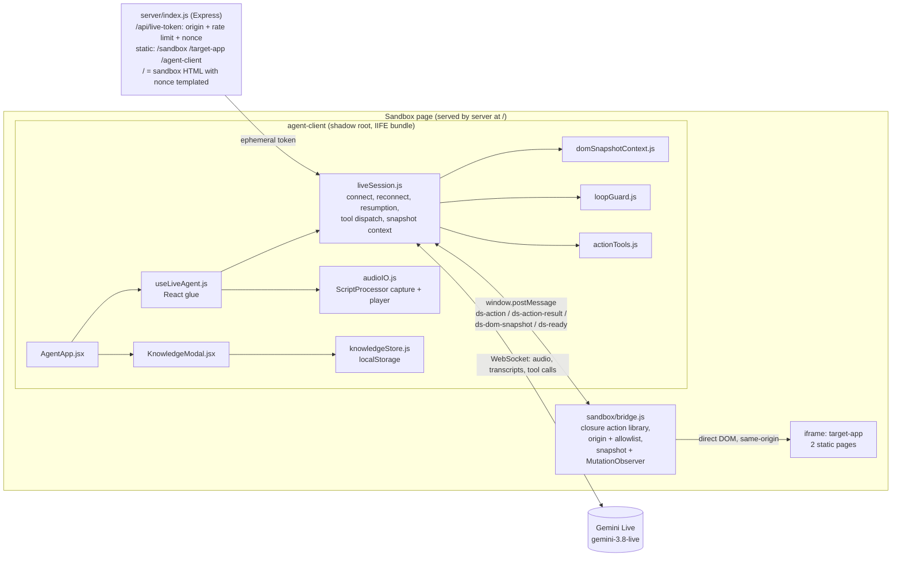

# Assessment — ai-presenter-agent v2 (2026-10-28)

Written at the start of the first `/build` cycle on this repo, from the code on
`m4-closed-loop` (PR #9, with `master` merged in), every doc in `docs/`, issues #1–#5,
PRs #6–#10, and a run of what exists.

## 1. Product and where it stands

A voice avatar (Gemini Live) mounted in a shadow root on a sandbox page. It talks and acts
(click / scroll / fill / navigate) on a same-origin iframe target app through a
`postMessage` bridge. It also has a "RAG-lite" knowledge modal (files + strict rules in
`localStorage`, stuffed into the session as context). Scope is the runtime only (see
`docs/project-knowledge-handoff.md` §2).

| Milestone | Issue | PR | State |
|---|---|---|---|
| M1 Server + voice channel | #1 closed | #6 merged | done |
| M2 Knowledge / RAG-lite | #2 closed | #7 merged | done |
| M3 Sandbox scaffolding | #3 closed | #8 merged | done |
| M4 Closed loop (grounding + tools + completion detection) | #4 open | **#9 open, no reviews** | in flight |
| M5 Hardening + tuning | #5 open | — | not started |
| Kit adoption | — | #10 merged | done |

PR #9 now has `master` merged in (pushed as `cf1d9bd`), so it carries the kit.

## 2. Architecture as it really is

The M4 refactor split the old 294-line `useLiveAgent.js` into `liveSession.js` (305 lines,
now the riskiest file), `audioIO.js` and a 59-line hook. `CLAUDE.md` still points at the old
shape.

## 3. Conventions the code follows (versus `stack-conventions`)

| Area | This repo | Kit | Proposal? |
|---|---|---|---|
| Language | Plain JS/JSX, ESM | TypeScript strict | Yes: `checkJs` with JSDoc types, or a TS migration (user decides) |
| React | 19 + Compiler, no manual memo, `useSyncExternalStore` for the store | same | — |
| Primitives | Radix Dialog | Radix | — |
| Server data | none (no app API besides the token) | TanStack Query | N/A |
| Forms | one textarea | TanStack Form + Zod | N/A at this size |
| Structure | flat `src/` | `src/features/*` | No: 12 files, flat is fine |
| Tests | `src/__tests__/*.test.js` | next to the file | No: keep the repo's pattern |
| Server | one 127-line `index.js`, `console.log`, no Zod config, no helmet, `X-Powered-By` on | `node-api.md` shape, pino, helmet, Zod config, `/health` | Yes, scaled down (see §4) |
| Versions | caret ranges (`^2.22.0`) for a fast-moving SDK | exact stable | Yes (review item M8) |
| Comments | dense "why" comments that cite the review checklist | why-comments | — (matches) |

## 4. Quality baseline versus `quality-gates`

| Gate | Exists? | Result today | Risk of the gap |
|---|---|---|---|
| Unit tests (agent-client) | yes, vitest | **25/25 pass** (domSnapshotContext, knowledgeStore, loopGuard, pcm) | `liveSession.js`, `bridge.js`, `server` have **zero** tests |
| Build | yes | **clean**, `agent-client.js` 620 kB / **148.6 kB gzip** | — |
| Lint | no | — | hooks-rule and dead-code mistakes go unseen |
| Format | no | — | low |
| Types | no | — | arg-shape bugs across the postMessage seam |
| `npm run check` | no | — | there is no single gate command |
| e2e (Playwright) | no | — | the voice + action loop is verified only by hand |
| CI | no | — | nothing runs on a PR |
| `protect-master.sh` | not run | — | unknown whether `master` is protected |
| Server tests | no | — | the token gate (origin / nonce / rate limit) is untested |

The live loop can be tested in a real browser without a human voice. Chromium's
`--use-fake-device-for-media-stream --use-file-for-fake-audio-capture=<wav>` feeds a
recorded prompt to `getUserMedia` (macOS `say` can produce the WAV). That makes an opt-in,
key-gated live e2e possible, next to a deterministic bridge e2e that needs no Gemini.

## 5. Findings on PR #9 (read and run, not yet fixed)

| # | Sev | Finding |
|---|---|---|
| A1 | High | **`/sandbox/` is broken for the agent.** `express.static('/sandbox')` serves `index.html` with the literal `%%DS_NONCE%%`; only `/` templates the nonce. The README says to open `/sandbox/` (on port 8787; the server defaults to 3000), so the documented path 403s on the token. Verified with curl. |
| A2 | High | **B2 reintroduced one layer up.** When the session goes `failed`, the button shows "Connect". `useLiveAgent.connect()` then starts a new capture and player without stopping the previous ones (`disconnect()` was never called), which leaks a live mic stream and an `AudioContext`. There is also no unmount cleanup: the window listeners in `liveSession` are never removed and the hook doesn't close anything (M4). |
| A3 | High | **Status lies during retries.** A token or connect failure sets `failed` and then schedules a retry, so the UI says "failed" while it is still reconnecting. There is no `reconnecting` state and no retry affordance (spec goal #6). The handoff doc §5.2 describes a Radix Toast that does not exist in this rebuild. |
| A4 | High | **Session-token binding on the bridge (spec goal #1) is still not built.** `bridge.js` says "deferred to M4/M5". Neither PR #9 nor the checklist records the deferral, and `event.source` is not checked. Issue #4's "done when" needs it closed or explicitly deferred. |
| A5 | Med | A bridge action that throws never replies, so the client waits the 4 s timeout (M3, still open). |
| A6 | Med | `liveSession.js` has no tests (H2). PR #9 defers them to M5, but it is the riskiest file. |
| A7 | Low | The bridge posts the load snapshot *before* `ds-ready`, so `markNavigated()` forces a redundant keyframe on the next mutation. |
| A8 | Low | Transcript fragments are appended one entry per fragment, are unbounded, and have no `aria-live`. |
| A9 | Low | 500s echo `err.message` to the browser. |

## 6. Metrics

Measurable automatically:
- bundle size (gzip);
- Lighthouse and axe on `/` (the sandbox page plus the widget);
- console errors and 5xx during e2e;
- token-endpoint latency;
- bridge action round-trip;
- snapshot payload size.

Specific to this app, measured through the opt-in live e2e (fake-mic WAV, real key):
- **connect time** (click → `open`);
- **time to first agent audio**;
- **tool-call round-trip** (toolCall → bridge → sendToolResponse);
- **action success rate** across a scripted multi-step task;
- **reconnect recovery time** after a forced socket close;
- **snapshot tokens per turn** (keyframe vs delta).

Budgets: the kit defaults apply to `/`. The widget bundle is held to ≤ 150 kB gzip (148.6
today, no headroom).

## 7. Docs audit

| Doc | State | Action |
|---|---|---|
| `CLAUDE.md` | **stale** | Says `useLiveAgent.js` is the riskiest file with zero tests (it's 59 lines now; `liveSession.js` is the risk). Lists `renderIsolation` and the `VolumeMeter` / `TranscriptLog` / `Toast` files, none of which exist in the rebuild. Says "three npm roots" for 2 packages + 2 static dirs. No gate commands. Update. |
| `README.md` | **stale / wrong** | Gives port 8787 and URL `/sandbox/` (see A1); "greets once the iframe loads" (it greets on Connect); says "3 terminals"; test list names files that don't exist. Rewrite the run/test sections. |
| `docs/project-knowledge-handoff.md` §3–§5 | **stale** | Model is `gemini-3.1-flash-live-preview` (now legacy, shuts down 2026-11-17; code uses `gemini-3.8-live`); the bundle is "282 KB gzip" (148.6); test counts; Toast; `useLiveAgent.js` internals; "live loop never run" (PR #9 says it was). Update §3 and §5; §1–§2 are origin and stay. |
| `docs/demostack-ai-presenter-agent.md` | mostly current | Goals #8/#9 (volume meter in a ref, render-count test) are **not built in the rebuild**. Either build them or mark them dropped. |
| `docs/sandbox-simulation.md` | current | Fix typo L12 ("sandbard"). |
| `docs/code-review-notes.md` | **drifted** | B1/B2/H3/H4 and most of H1/H5 are fixed per its own editorial notes, but **every box is unchecked** and line refs point at deleted code. Tick and annotate in place. |
| `docs/agents/*.md` | current | — |
| `docs/adr/`, `CONTEXT.md` | missing | Create lazily. Worth an ADR each for the decisions §4 of the handoff already logs, only if the user wants them back-filled. A glossary is worth it: keyframe/delta, bridge, nonce, generation, loop guard. |
